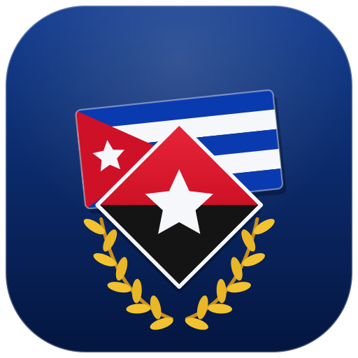

# CeiOS — El sistema operativo de la ciencia y la investigación

<p align="center">
  
</p>

> **CeiOS** («Ciencia e Investigación OS») es una distribución Linux ligera basada en **Debian 12 (bookworm)** con escritorio **LXQt**, diseñada para científicos, estudiantes e investigadores que trabajan con equipos modestos. Objetivo de referencia: un Chromebook con **16 GB de disco y 2 GB de RAM**, dejando espacio real para trabajar.

**Estado: v0.1 «Tocororo»** — ISO oficial compilada automáticamente por CI en cada actualización de `main`.

## Descargar la ISO oficial

La ISO se compila sola en GitHub Actions y se publica en la **release oficial**:

1. Abre **[Releases](https://github.com/SamyOsiel/CeiOS/releases/tag/v0.1-tocororo)**.
2. Descarga `ceios-0.1-tocororo-amd64.iso` y `SHA256SUMS`.
3. Verifica: `sha256sum -c SHA256SUMS`
4. Graba en un USB (≥ 4 GB) con Rufus, Ventoy o `dd`.

También puedes descargarla como **artefacto** del workflow en la pestaña [Actions](https://github.com/SamyOsiel/CeiOS/actions) (requiere iniciar sesión en GitHub).

[](https://github.com/SamyOsiel/CeiOS/actions/workflows/build-iso.yml)

## Características

- Apariencia moderna tipo **Windows 11**: tema GTK **Fluent** con acento **rojo** (colores cubanos), barra de tareas centrada, esquinas redondeadas y compositor ligero (picom).
- Identidad visual con los **colores de la bandera cubana**: azul `#002A8F`, rojo `#CE1126`, blanco `#FFFFFF`.
- **Fondo de escritorio personalizable**: `scripts/make-wallpaper.sh` integra tu imagen, **centrada**, sobre un diseño azul/rojo/blanco generado por el sistema.
- Optimizada desde el primer arranque para **2 GB de RAM**: zram con lz4, LXQt sobre X11 y perfil bajo consumo de servicios.
- Herramientas del investigador: **Zotero**, LibreOffice, Firefox ESR y módulos opcionales de LaTeX, Python científico y OnlyOffice.
- Módulos opcionales (con tu propia licencia) para **Microsoft Office 2016** y **EndNote** vía Wine.

## Software: incluido frente a licencia propia

| Software | Estado en CeiOS | Cómo se obtiene |
| --- | --- | --- |
| Zotero | Módulo de instalación incluido (nativo) | `scripts/install-zotero.sh` |
| LibreOffice (es) | Incluido en la ISO | preinstalado |
| Firefox ESR (es) | Incluido en la ISO | preinstalado |
| OnlyOffice Desktop | Módulo gratuito opcional | `scripts/install-onlyoffice.sh` |
| LaTeX ligero | Módulo opcional | `scripts/install-latex-light.sh` |
| Python científico | Módulo opcional | `scripts/install-python-ciencia.sh` |
| **Microsoft Office 2016** | Requiere TU licencia | `scripts/setup-wine-office2016.sh` — ver `docs/02` |
| **EndNote** | Requiere TU licencia | `scripts/setup-wine-endnote.sh` — ver `docs/03` |

> **Aviso legal.** Microsoft Office, Windows, EndNote y Zotero son marcas de sus respectivos propietarios. CeiOS **no incluye, redistribuye ni activa** software propietario: los módulos Wine solo preparan el entorno (Wine, winetricks, accesos directos) y requieren que el usuario aporte su propio instalador y licencia válida.

## Presupuesto de recursos

| Concepto | Objetivo en la Chromebook (16 GB / 2 GB) |
| --- | --- |
| Tamaño de la ISO | ~1,5–1,8 GB |
| Sistema instalado | ≤ 6,5 GB |
| Espacio libre para datos | ≥ 9 GB (consejo: datos grandes en tarjeta SD) |
| RAM en reposo | ~450–600 MB |
| RAM con Firefox + Zotero | ~1,3–1,6 GB (el zram absorbe los picos) |

## Estructura del repositorio

```
CeiOS/
├── build/                  Sistema de compilación de la ISO
│   ├── Dockerfile          Entorno reproducible de compilación (Debian 12)
│   ├── ci-prepare.sh       Regenera PNGs de marca y el fondo oficial
│   ├── build.sh            Script principal (sincroniza + live-build)
│   └── lb-config/          Configuración de live-build (auto, paquetes, hooks)
├── scripts/                Módulos de post-instalación y aplicaciones
├── theme/                  Configuración de escritorio incluida en la ISO
│   └── includes.chroot/    (panel LXQt, fondo, sysctl, zram, entradas de menú)
├── assets/                 Marca: emblema (rombo + estrella + laurel + bandera), icono y fondo
├── docs/                   Documentación técnica en español
└── .github/workflows/      CI: compila la ISO en cada push y publica la release oficial
```

## Compilar la ISO tú mismo (resumen)

```bash
# Con Docker (recomendado)
docker build -t ceios-builder build/
docker run --rm -v "$PWD":/work ceios-builder

# Resultado: images/ceios-0.1-tocororo-amd64.iso
```

Cada `push` a `main` dispara la misma compilación en GitHub Actions y actualiza la ISO de la release oficial. Detalles completos en [docs/06-compilar-iso.md](docs/06-compilar-iso.md).

## Instalar en una Chromebook (resumen)

1. Verifica que tu modelo está soportado por el firmware **MrChromebox** (solo Intel/AMD).
2. Flashea el firmware UEFI Full ROM (ver [docs/01-instalacion-chromebook.md](docs/01-instalacion-chromebook.md)).
3. Graba la ISO en un USB de 4 GB y arranca desde él.
4. Instala con Calamares ocupando todo el disco; CeiOS aplica zram y el perfil bajo consumo automáticamente.

## Hoja de ruta

- **v0.1 «Tocororo»** — esqueleto reproducible (este repositorio).
- **v0.2** — primera ISO probada en QEMU con 2 GB de RAM y ajuste fino del tema.
- **v0.3** — branding completo: GRUB, SDDM y Calamares con la paleta cubana.
- **v0.4** — asistente gráfico de módulos y perfiles de investigación (bio, social, ingeniería).

## Licencia

Código, scripts y documentación bajo licencia [MIT](LICENSE). Cada componente del sistema conserva su propia licencia (Debian, LXQt, Firefox, LibreOffice, Zotero, Fluent-gtk-theme, Papirus, etc.).
